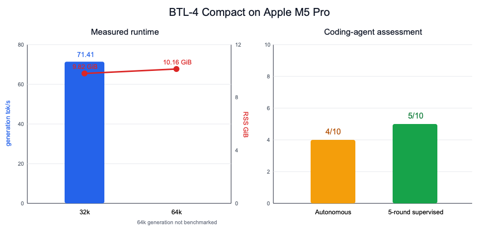

# BTL-4 Compact

Profiles: `btl-4-compact`. All measurements are from the Apple Silicon host.

## Overview

[BTL-4 Compact](https://huggingface.co/badtheorylabs/BTL-4-Compact) packages the 35.1B-parameter, roughly 2.1B-active MoE as a 9.3 GiB `IQ2_XXS` GGUF. It requires recent upstream llama.cpp with `qwen35moe` support. The included profile runs at 65,536 context with q8_0 K/V cache and the model card's required Jinja and DeepSeek reasoning settings:

```bash
scripts/download-model.sh btl-4-compact
scripts/run.sh btl-4-compact
pi --provider local-workbench --model btl-4-compact
```

On the Mac, a 32k smoke test generated at **71.41 tok/s**, used about **9.82 GiB RSS** after loading, returned the requested exact response, and emitted a correct OpenAI-compatible tool call. At 65k, idle RSS was about **10.16 GiB** and peak observed RSS during the coding run was about **10.54 GiB**.

## Coding-agent assessment

The 65k direct-prompt agent completed a TypeScript project in 7.94 minutes without context compaction. Five supervised correction rounds made its mocked tests and TypeScript checks pass, but independent review still rejected the production path: face detection and ffmpeg trimming remained placeholders, command execution used a shell, and destination key construction was wrong. BTL-4 is promising as a fast supervised pair programmer, not a production-reliable autonomous agent; subjective assessment is **4/10 autonomous, 6/10 with five-round supervision**.



The chart intentionally leaves 64k generation blank because no controlled 64k throughput smoke benchmark was run. Machine-readable measurements are in `results/btl-4-compact-results.json`.

`--jinja` and `--reasoning-format deepseek` are required for this model's tool-call template and reasoning separation. `scripts/run.sh` reads the latter from `REASONING_FORMAT` in the profile.
