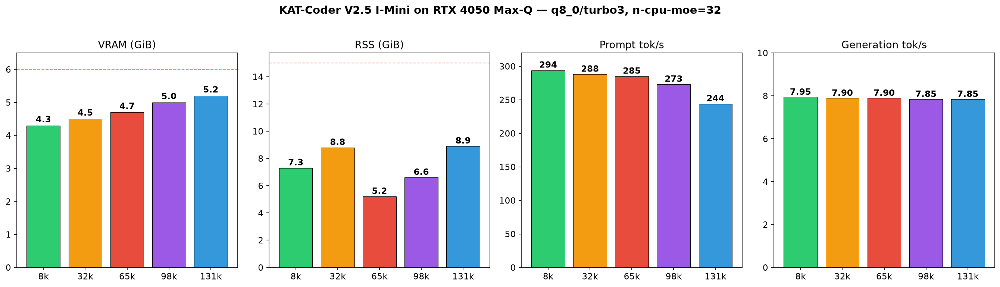
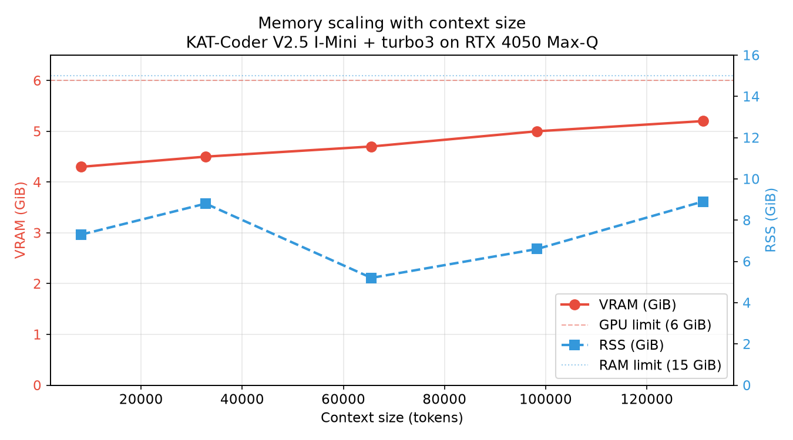
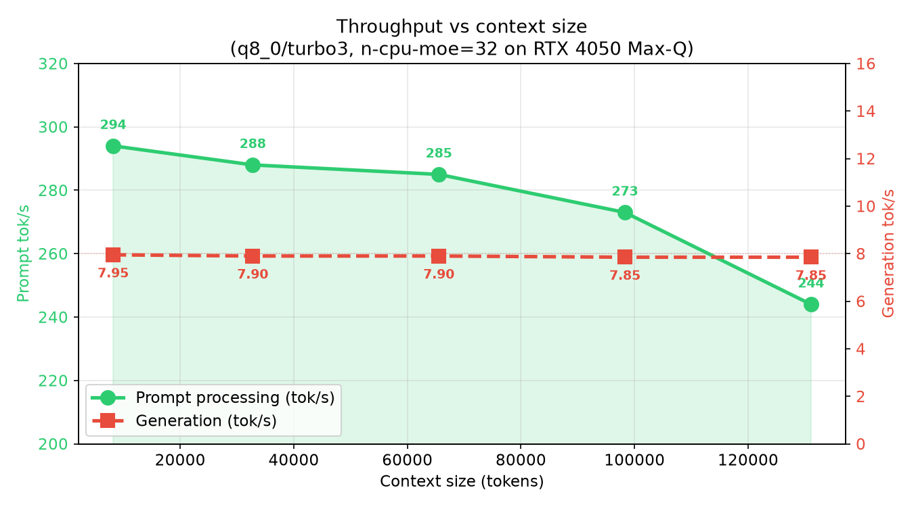
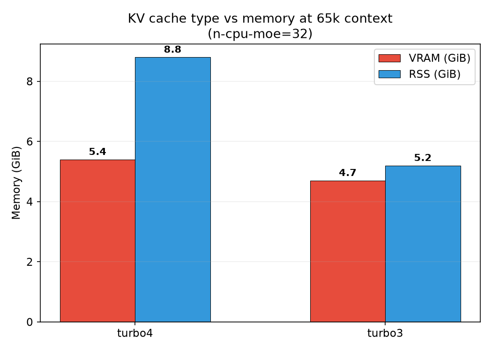

# KAT-Coder

Profiles: `kat-coder`, `kat-coder-mtp`. The reference graphs below were measured on an RTX 4050 Max-Q Linux host; hardware and fixed configuration are included in each chart.

## Linux/NVIDIA reference graphs

These plots show the earlier KAT-Coder I-Mini measurements on an RTX 4050 Max-Q.

## MTP benchmark

The `kat-coder-mtp` profile uses the embedded MTP head with the publisher's recommended `draft-mtp,ngram-mod` configuration. Two deterministic 512-token runs were measured at each configured context with `q8_0/turbo3`, full Metal offload, and a 38-token coding prompt.

| Context | Original | MTP + ngram | Gain | Draft acceptance |
|---:|---:|---:|---:|---:|
| 65,536 | 55.00 tok/s | **63.37 tok/s** | **15.2%** | 96.7% |
| 98,304 | 55.48 tok/s | **63.62 tok/s** | **14.7%** | 96.7% |
| 131,072 | 55.41 tok/s | **64.24 tok/s** | **15.9%** | 96.7% |

The MTP-file-only matrix produced these means:

| Context | None | ngram | MTP | MTP + ngram | Winner |
|---:|---:|---:|---:|---:|---|
| 65,536 | 56.26 | 55.84 | 61.64 | **63.37** | MTP + ngram |
| 98,304 | 64.14 | 64.40 | **69.45** | 63.62 | MTP |
| 131,072 | 64.15 | 63.38 | **64.54** | 64.24 | MTP (near tie) |

All three context sizes loaded and completed. These are short-prompt generation tests, not near-window context validation; the two-run 131k MTP result was noisy. Raw metrics and aggregates are in `results/mtp-benchmark-results.json`.

A longer 8,192-token video-preextractor prompt exposed quality failures in both models. The original hit the output limit during its tests; MTP stopped after 2,391 tokens in the middle of the implementation. Both hallucinated the PyTorchVideo API (`EncodedVideo(path)` and unsupported `get_clip` arguments instead of the documented `EncodedVideo.from_path(path)` flow). MTP was 12.7% faster, but neither response was runnable. See `results/mtp-video-preextractor-results.json`.

Sequential Pi coding-agent runs reached the same conclusion. MTP completed its tool loop 5.13x faster (5.06 versus 25.95 minutes), but both agents wrote tests around invented APIs and then reported success. Independent review found neither implementation runnable with PyTorchVideo. Workspaces and review data are under `results/pi-subagents/`.
