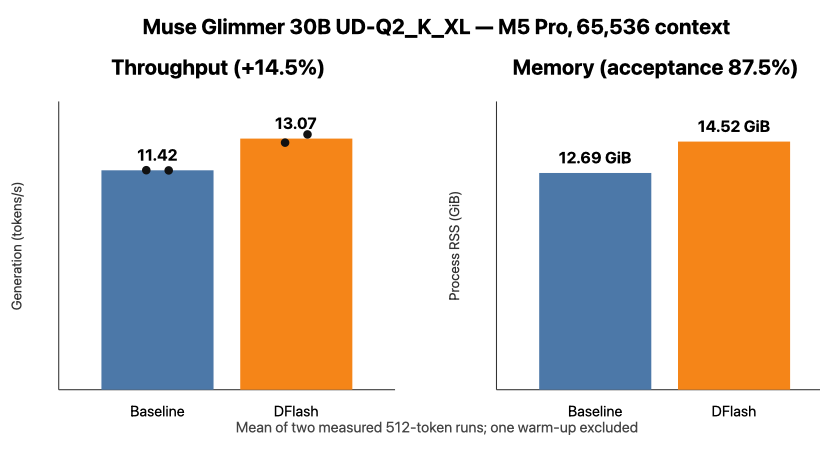

# Muse Glimmer

Profiles: `muse-glimmer`, `muse-glimmer-dflash`. All measurements are from the Apple Silicon host.

## DFlash benchmark

Muse Glimmer 30B `UD-Q2_K_XL` was tested on the Mac at 65,536 configured context using upstream llama.cpp commit `dd1ea524333b1e697489067d7a4c39c60d32beee`. The target GGUF is 11.59 GiB; Meta's DFlash drafter adds 1.52 GiB. One warm-up and two measured 512-token runs used full Metal offload, Flash Attention, one slot, and `f16/f16` KV cache.

| Mode | Generation | RSS | Draft acceptance |
|---|---:|---:|---:|
| Baseline | 11.42 tok/s | 12.69 GiB | n/a |
| DFlash | **13.07 tok/s** | 14.52 GiB | 87.5% |

DFlash improved generation by **14.5%** and produced byte-identical deterministic responses. This is useful but much smaller than Meta's M5 Max ExecuTorch result; backend and hardware differences matter. Raw aggregates are in `results/muse-glimmer-dflash-results.json`.

An isolated Pi coding agent completed the video-preextractor task in 11.16 minutes with 13 tool calls and no tool errors. It used the documented PyTorchVideo API correctly, unlike the earlier KAT agents, but independent review still found missing worker support, filename collisions, stale overwrite manifests, and vacuous resume/corruption tests. The workspace and review are under `results/pi-subagents/muse-glimmer-dflash/`.

Muse Glimmer requires a recent upstream llama.cpp with the `muse-glimmer` architecture; the pinned TurboQuant commit does not load it. `scripts/download-model.sh muse-glimmer-dflash` resolves both the target and companion draft GGUF. The DFlash profile uses `--model-draft`, `--spec-type draft-dflash`, and `--spec-draft-n-max 15`.
