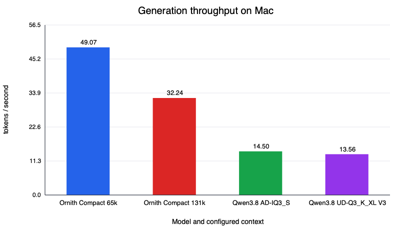
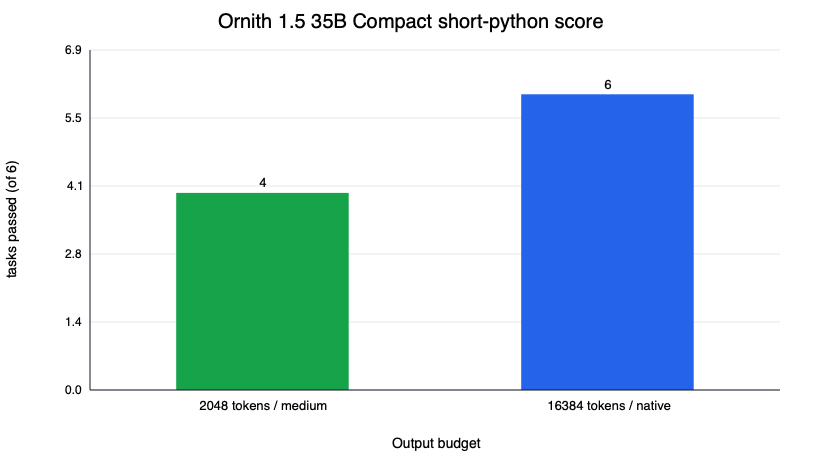

# Ornith 1.5 35B

Profiles: `ornith15-35b-apex-compact`, `ornith-35b-i-mini`, `ornith15-9b-q8`. All measurements are from the Apple Silicon host.

## APEX Compact

[Ornith 1.5 35B A3B](https://huggingface.co/ornith-ai/Ornith-1.5-35B-A3B) is a 36B-parameter MoE with about 3B active parameters per token. Mudler's [APEX Compact](https://huggingface.co/mudler/Ornith-1.5-35B-A3B-APEX-GGUF) quantizes the routed experts harder than the always-active parts, producing a 16,538,851,328-byte GGUF (SHA-256 `846eb4121c1b28df0e2dff06c3f3d174084231a7400c649ba02023843ea41021`). It requires recent upstream llama.cpp with `qwen35moe` support. The included profile prefers 131,072 context with `f16/f16` KV cache:

```bash
scripts/download-model.sh ornith15-35b-apex-compact
scripts/run.sh ornith15-35b-apex-compact
pi --provider local-workbench --model ornith15-35b-apex-compact
```

It is the fastest large model measured in this workbench:

| Context | Prompt processing | Generation | Process RSS |
|---:|---:|---:|---:|
| 65,536 | 68.74 tok/s | **49.07 tok/s** | 16.96 GiB |
| 131,072 | 151.50 tok/s | **32.24 tok/s** | 18.00 GiB |

RSS includes mmap-backed pages and is not entirely private physical memory. For comparison, the dense Qwen3.8 27B Q3 models generate at 14-15 tok/s on the same machine.



A long-context request processed 97,108 actual prompt tokens at 162.53 tok/s and then generated at 17.08 tok/s, finishing normally. The validation harness's character estimate undershot the configured 131,072-token ceiling, so a near-window fill remains untested.

On the six-task `short-python-v1` suite, Ornith scored 4/6 at medium reasoning with a 2,048-token limit, then **6/6** at 131,072 context with a 16,384-token allowance. The two former failures completed in 3,689 and 2,182 tokens, confirming they were constrained-completion failures, not wrong code. The second run requested `xhigh`, but Ornith reasons natively and its template may ignore named reasoning-effort levels. Machine-readable results are in `results/ornith15-35b-apex-compact-results.json`.


