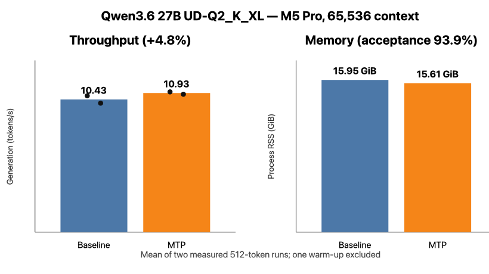
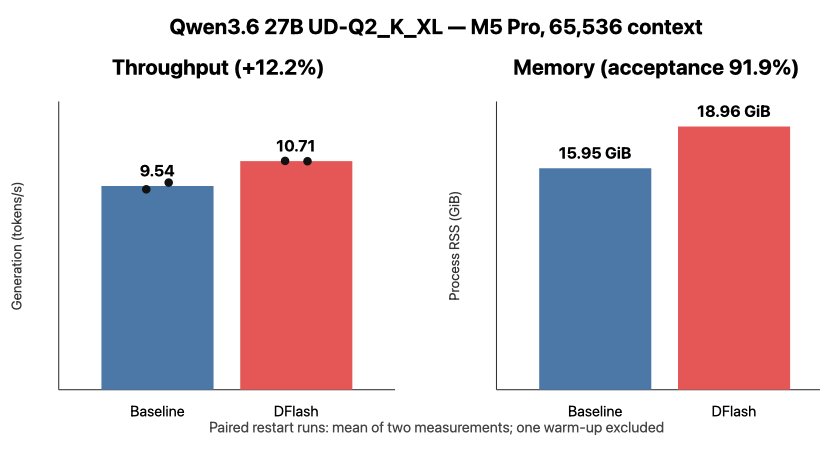

# Qwen3.6 27B Q2

Profiles: `qwen36-27b-q2`, `qwen36-27b-q2-mtp`, `qwen36-27b-q2-dflash`. All measurements are from the Apple Silicon host.

## MTP benchmark

Qwen3.6 27B `UD-Q2_K_XL` baseline and MTP GGUFs were tested at 65,536 context using upstream llama.cpp commit `dd1ea524333b1e697489067d7a4c39c60d32beee`. One warm-up and two measured 512-token runs used full Metal offload, Flash Attention, one slot, and the publisher's `draft-mtp` maximum of two draft tokens.

| Mode | Generation | RSS | Draft acceptance |
|---|---:|---:|---:|
| Baseline | 10.43 tok/s | 15.95 GiB | n/a |
| MTP | **10.93 tok/s** | 15.61 GiB | 93.9% |

MTP improved generation by only **4.8%**, despite high acceptance, and all six deterministic responses were byte-identical. This is better than the earlier TurboQuant Q3_K_M result, where MTP was 40.7% slower, but too small to justify a coding-agent comparison yet. Raw aggregates are in `results/qwen36-27b-q2-mtp-results.json`.

A targeted 65k autotune compared three KV combinations and `1024/2048` batch and ubatch sizes. `f16/f16` with `1024/1024` won at 98.53 prompt tok/s and 9.49 generation tok/s on a 60,504-token prompt. The best `q8_0/q8_0` candidate used about 1.9 GiB less RSS but was 9.5% slower for prompt processing and 17.2% slower for generation; mixed `q8_0/f16` candidates exceeded the 900-second request timeout. See `results/qwen36-27b-q2-autotune-results.json`.

## DFlash

The same target was also tested with Alittlehammmer's recommended Q8_0 DFlash drafter and `--spec-draft-n-max 6`. Because sequential exploratory runs varied with system state, the reported comparison restarted each server and spaced its runs by 30 seconds.

| Mode | Generation | RSS | Draft acceptance |
|---|---:|---:|---:|
| Paired baseline | 9.54 tok/s | 15.95 GiB | n/a |
| DFlash Q8_0 | **10.71 tok/s** | 18.96 GiB | 91.9% |

DFlash gained **12.2%** in the controlled pair and preserved byte-identical output, but added about 3.0 GiB RSS. Earlier exploratory DFlash runs ranged from 10.53 to 18.36 tok/s, so the isolated peak is not treated as sustained performance. Results are in `results/qwen36-27b-q2-dflash-results.json`.
