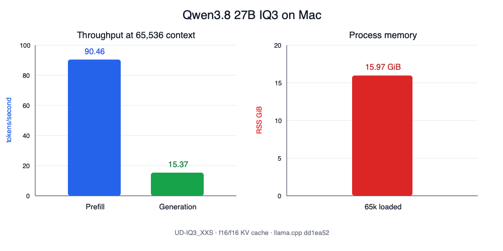
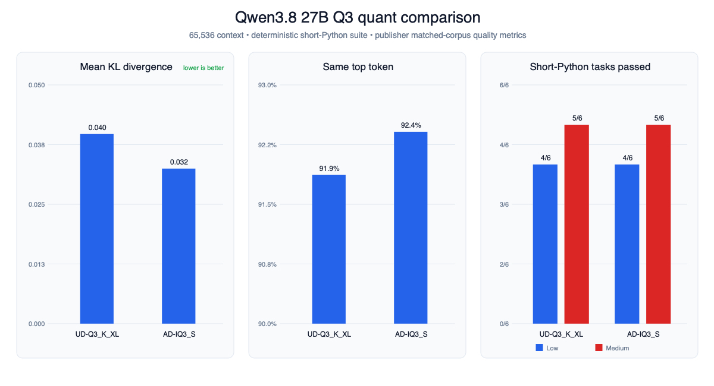
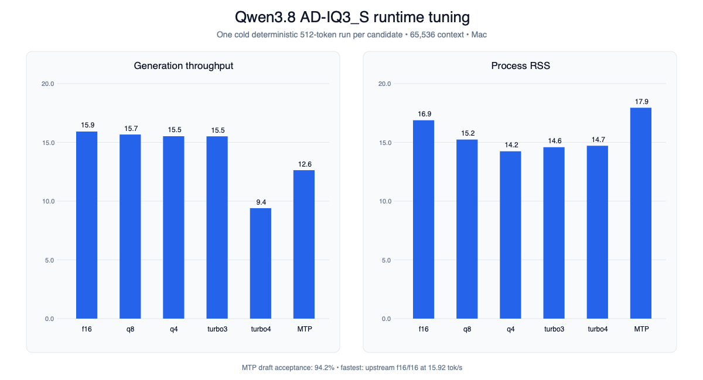

# Qwen3.8 27B

Profiles: `qwen38-27b-iq3`, `qwen38-27b-ud-q3`, `qwen38-27b-ad-iq3`. Machine-readable records are referenced throughout; all measurements are from the M5 Pro-class Apple Silicon host.

## IQ3 baseline

[Qwen3.8 27B](https://huggingface.co/unsloth/Qwen3.8-27B-GGUF) is a dense hybrid thinking model with a native 262,144-token context window. The included `UD-IQ3_XXS` profile starts conservatively at 65,536 context with `f16/f16` KV cache and the recommended thinking defaults: temperature 1.0, top-p 0.95, top-k 20, min-p 0, zero presence penalty, xhigh reasoning, and preserved thinking.

```bash
scripts/download-model.sh qwen38-27b-iq3
scripts/run.sh qwen38-27b-iq3
scripts/benchmark.sh qwen38-27b-iq3
pi --provider local-workbench --model qwen38-27b-iq3
```

The 11,913,559,104-byte GGUF has SHA-256 `0a6129dcbbbe72f423dc67e0e3bbfbbdf3e923981a3637687ebb96a46c59d6be`.

| Context | KV cache | Prefill | Generation | Process RSS |
|---:|---|---:|---:|---:|
| 65,536 | `f16/f16` | 90.46 tok/s | **15.37 tok/s** | 15.97 GiB |



Exact chat, Pi, and structured tool-call smoke tests passed.

Reasoning effort matters substantially. Xhigh consumed 2,048 tokens without reaching a final answer on a small coding prompt; low reasoning completed it correctly. A focused low-reasoning Pi agent built a mocked single-object S3 video processor in 18.68 minutes with six tool calls, no tool errors, no compaction, and three passing independently rerun tests. Independent review accepted it with limitations: configured prefixes were not validated, successful ffmpeg exit was trusted without checking for an output file, and failure-stage cleanup coverage was incomplete.

A medium-reasoning CSV evaluation task completed in 23.53 minutes with 21 tool calls, no tool errors, 11 passing generated tests, correct fixture metrics, and four valid PNG charts. Independent review rejected it because F1 raises `ZeroDivisionError` when precision and recall are both zero; its tests and final report incorrectly claimed complete zero-denominator coverage. Machine-readable results are in `results/qwen38-27b-iq3-results.json`.

The profile uses llama.cpp's native `--reasoning on` and `--reasoning-preserve` flags. `scripts/run.sh` also forwards profile-driven min-p, presence penalty, repetition penalty, and chat-template arguments.

## Q3 comparison

The 13,441,059,904-byte Unsloth `UD-Q3_K_XL` and 13,838,267,872-byte AtomicChat `AD-IQ3_S` GGUFs were checksum-verified and compared at 65,536 context with `f16/f16` KV cache. AtomicChat's published matched-corpus measurement favors AD-IQ3_S: mean KL divergence is 0.03247 versus 0.03972, and same-top-token agreement is 92.411% versus 91.869%.



Both quants scored **4/6** on `short-python-v1` with temperature 0, seed 42, low reasoning, and a strict 1,024-token completion limit. At medium reasoning with a 2,048-token limit, both improved to **5/6** by completing binary metrics correctly. Both medium runs still exhausted the limit during dependency ordering before returning complete source. These are constrained completion results, not evidence that the truncated algorithms would be incorrect with a larger budget. Raw comparisons are in `results/qwen38-27b-short-python-comparison.json` and `results/qwen38-27b-short-python-medium-comparison.json`.

A targeted AD-IQ3_S speed matrix used one cold deterministic 512-token run per candidate at 65,536 context, with 30 seconds between candidates:

| Backend | KV cache | Speculation | Generation | RSS |
|---|---|---|---:|---:|
| Upstream | `f16/f16` | None | **15.92 tok/s** | 16.88 GiB |
| Upstream | `q8_0/q8_0` | None | 15.67 tok/s | 15.24 GiB |
| Upstream | `q4_0/q4_0` | None | 15.52 tok/s | **14.24 GiB** |
| TurboQuant | `q8_0/turbo3` | None | 15.51 tok/s | 14.59 GiB |
| TurboQuant | `q8_0/turbo4` | None | 9.40 tok/s | 14.71 GiB |
| Upstream | `f16/f16` | MTP | 12.63 tok/s | 17.94 GiB |



MTP was slower despite 94.2% draft acceptance. No candidate reached 20 tok/s; `f16/f16` remained fastest, while `q8_0/q8_0` saved about 1.64 GiB for a 1.6% generation penalty. The winning configuration produced 16.08 tok/s on UD-Q3_K_XL. See `results/qwen38-27b-ad-speed-matrix.json` and `results/qwen38-27b-ud-f16-confirmation.json`.

A single Terminal-Bench 2.1 `cancel-async-tasks` smoke trial gave UD-Q3_K_XL a valid 0.0 after it implemented a synchronous function instead of the required async API. The first attempt was invalid because the verifier crashed under QEMU, and the AD-IQ3_S trial was interrupted before completion. This is not a paired Terminal-Bench comparison; the preserved summary is `results/qwen38-27b-terminal-bench-smoke.json`.
