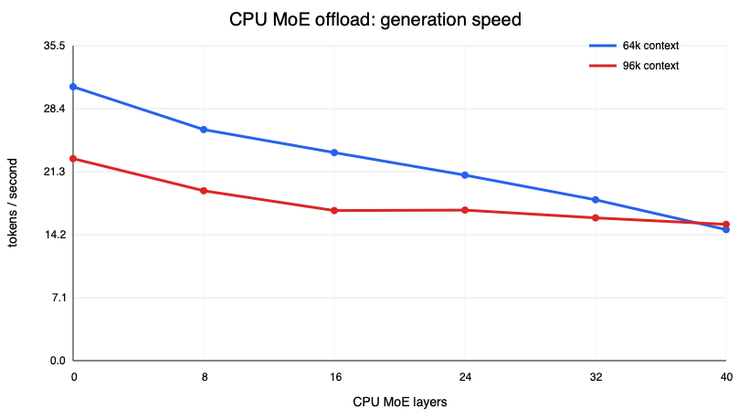
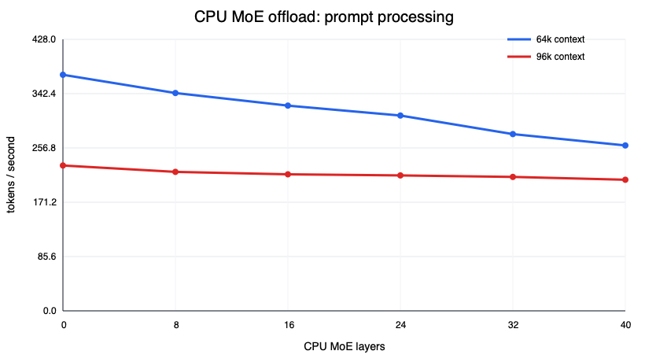

# CPU MoE offload

Hardware study on the Apple Silicon host: keeping MoE experts on CPU instead of Metal.

## Mac results

On a Mac, the measured winner kept every MoE layer on Metal and used 10 performance-core threads, `q8_0/turbo3` KV cache, and `1024/1024` batch/ubatch.

| Configured context | Actual prompt | Prompt processing | Generation | Process RSS |
|---:|---:|---:|---:|---:|
| 65,536 | 60,504 | 372.14 tok/s | **30.91 tok/s** | 13.63 GiB |
| 98,304 | 90,751 | 229.16 tok/s | **22.80 tok/s** | 13.97 GiB |

CPU MoE offload did not help: even 8 offloaded layers reduced generation by about 16% at both contexts, while RSS stayed effectively unchanged.

